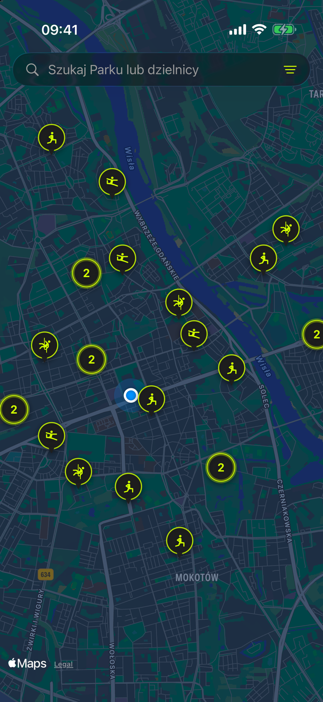
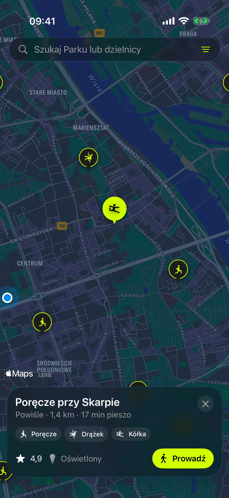
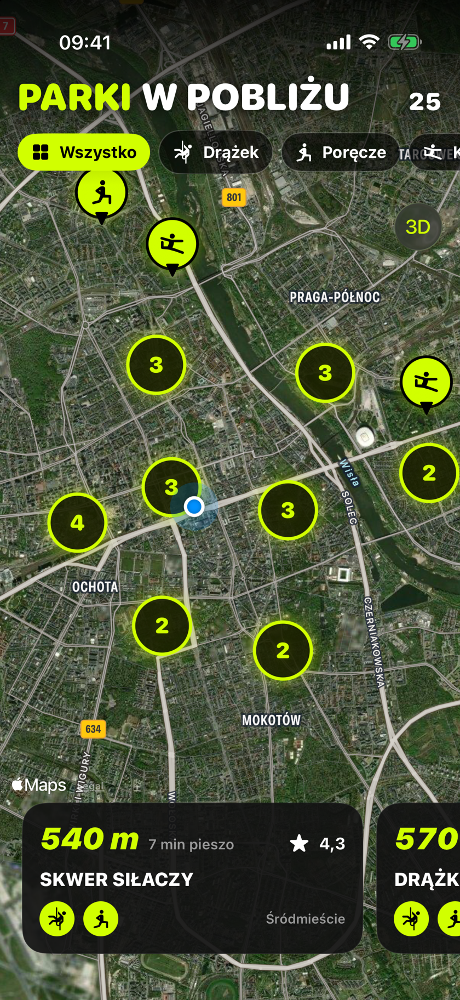
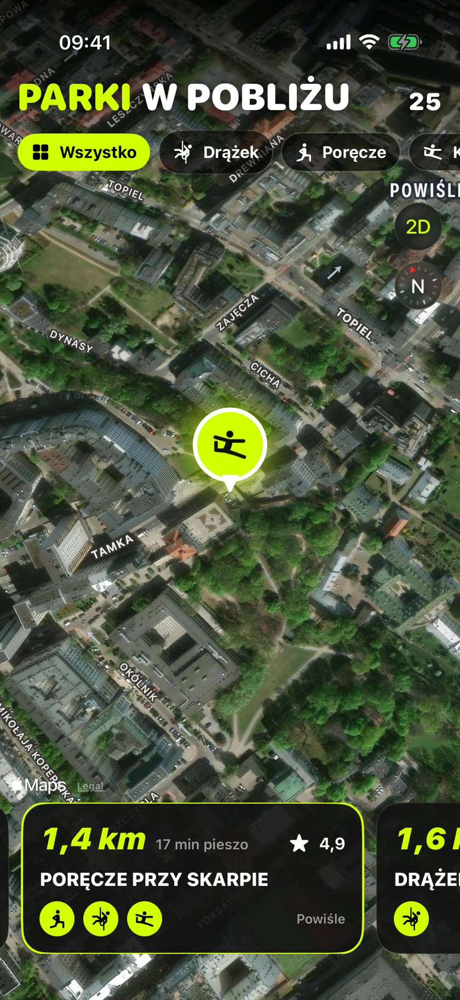
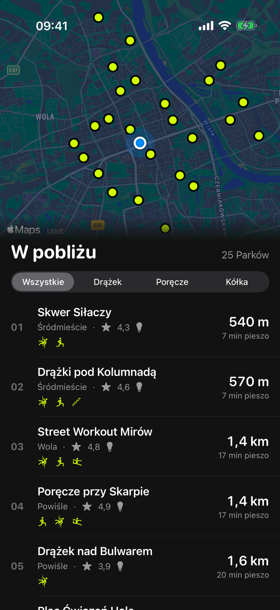
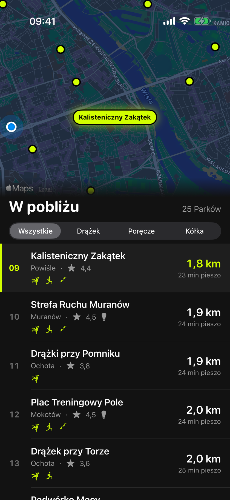
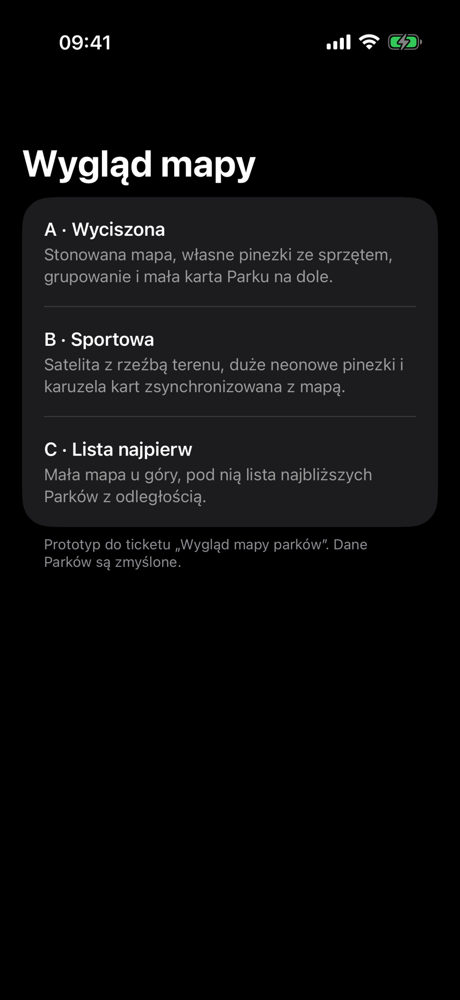

# Prototyp: wygląd mapy Parków

Ticket: [Wygląd mapy parków](../../tickets/011-map-look.md). Trzy warianty w MapKit dla SwiftUI, bez zewnętrznych SDK. Kod jest jednorazowy, leży w `cali-park/Prototypes/MapLook/` i kompiluje się tylko w buildzie Debug. Wszystkie 25 Parków i ich współrzędne są zmyślone. Pozycja „Tu jesteś” jest na sztywno przy Pałacu Kultury.

Każdy wariant ma dwa zrzuty: mapę na starcie i wybrany Park.

## A · Wyciszona

Stonowana ciemna mapa bez punktów POI. Własne pinezki z ikoną sprzętu, a sąsiednie Parki łączą się w kółko z liczbą. Po stuknięciu w pinezkę na dole pojawia się mała szklana karta Parku z przyciskiem „Prowadź”.

| Mapa | Wybrany Park |
| --- | --- |
|  |  |

## B · Sportowa

Zdjęcia satelitarne z nazwami ulic, duże neonowe pinezki i chipy filtrów sprzętu. Na dole jest karuzela kart: przesunięcie karty przelatuje kamerą nad Park w 3D, a stuknięcie w pinezkę przewija karuzelę.

| Mapa | Wybrany Park |
| --- | --- |
|  |  |

## C · Lista najpierw

Mała mapa u góry z wyraźnymi neonowymi kropkami, a pod nią lista najbliższych Parków z odległością i czasem dojścia. Stuknięcie w wiersz centruje mapę, a stuknięcie w kropkę przewija listę do Parku.

| Mapa | Wybrany Park |
| --- | --- |
|  |  |

## Jak uruchomić

W Xcode: **Product → Scheme → Edit Scheme… → Run → Arguments**, dodaj argument `-PrototypeMapLook` i uruchom apkę. Zamiast zwykłej apki pokaże się lista trzech wariantów. Biała pigułka u góry przełącza warianty strzałkami, a ✕ wraca do listy. Pigułka nie jest częścią projektu.



Z terminala, na włączonym symulatorze z zainstalowanym buildem Debug:

```sh
xcrun simctl launch booted com.michalbryk.cali-park -PrototypeMapLook
```

Dodatkowe argumenty, użyte do zrzutów:

- `-MapLookVariant A|B|C` otwiera od razu wybrany wariant,
- `-MapLookSelect 4` zaznacza Park o numerze 0–24,
- `-MapLookClean` chowa pigułkę przełącznika.

## MapKit a Mapbox

MapKit pozwala wyciszyć mapę, przełączyć ją na satelitę, schować POI i narysować własne pinezki, ale nie pozwala zmienić kolorów ulic, wody czy zieleni. Mapbox dałby w pełni własny styl mapy, na przykład grafitowe ulice z limonkowymi akcentami w kolorach apki. Kosztem jest zewnętrzne SDK, konto i opłaty po przekroczeniu darmowego limitu.
