# Prototyp: formularz zgłoszenia Parku

Ticket: [Formularz zgłoszenia parku](../../tickets/013-submission-form.md). Klikalny przepływ Zgłoszenia Parku w SwiftUI, w stylu mapy A „Wyciszona” ([ticket 011](../../tickets/011-map-look.md)) i według modelu Parku z [ticketu 012](../../tickets/012-park-model.md).

Kod jest jednorazowy. Leży w `cali-park/Prototypes/ParkSubmission/` i kompiluje się tylko w buildzie Debug. Nic nie jest wysyłane ani zapisywane, wszystko żyje w pamięci. Parki na mapie, nazwy okolic, Zgłoszenia w „Moje zgłoszenia” i Pseudonim `kuba_na_drazku` są zmyślone. Pozycja „Tu jesteś” jest na sztywno w Parku Skaryszewskim.

Formularz ma dwa układy do wyboru: **A · Kroki** i **B · Jeden arkusz**. Mapa, ostrzeżenie o duplikacie, podsumowanie i „Moje zgłoszenia” są w obu takie same.

## Wymagane i opcjonalne

Wymagane są tylko trzy rzeczy z 012:

- **położenie:** pinezka na mapie,
- **dowód, że to Park:** drążek albo poręcze w sprzęcie i co najmniej jedno zdjęcie z miejsca,
- **źródło:** ustawiane samo na „zgłoszenie użytkownika”, widoczne w podsumowaniu.

Reszta jest opcjonalna i da się ją pominąć: liczba i wysokość drążków, liczba poręczy, dodatkowy sprzęt, „obok są maszyny”, nazwa z tabliczki, nawierzchnia, oświetlenie, zadaszenie i dostęp. Nie ma pola na wolny opis (decyzja z 012).

## 1. Wejście z mapy

| Mapa | Stawianie pinezki | Ten Park już jest obok | „To ten. Otwórz Park” |
| --- | --- | --- | --- |
| 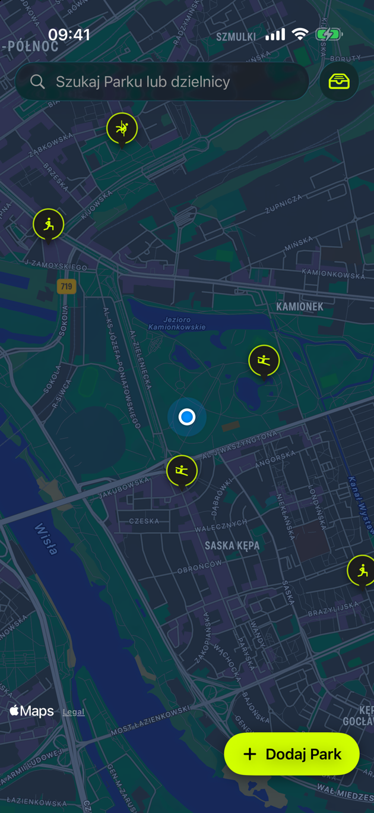 | 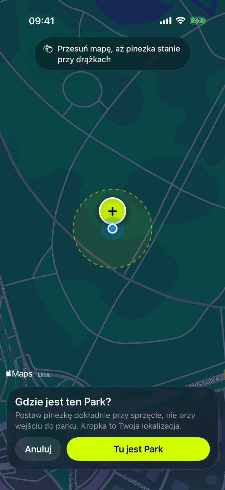 | 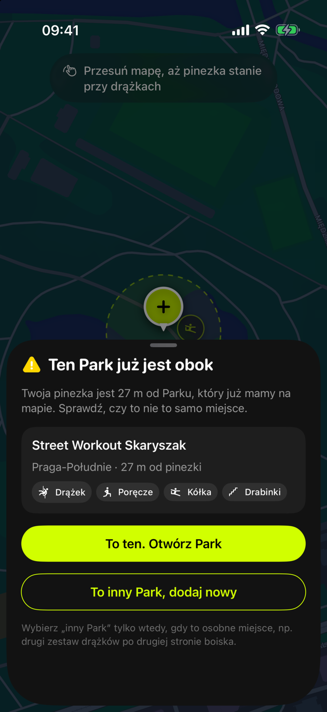 | 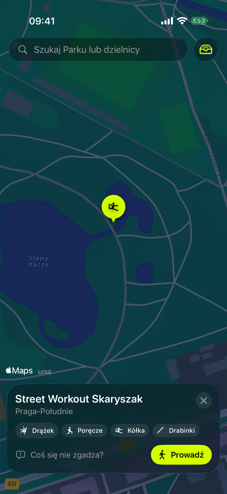 |

- **Mapa:** wariant A z przyciskiem „Dodaj Park” w prawym dolnym rogu. Ikona tacki obok wyszukiwarki otwiera „Moje zgłoszenia”.
- **Stawianie pinezki:** mapa przybliża się do Twojej lokalizacji. Pinezka z plusem stoi na środku, a Ty przesuwasz mapę pod nią. Przerywane kółko pokazuje promień 50 m, w którym szukamy duplikatów. Istniejące Parki są przygaszone i podpisane, żeby było widać, co już jest.
- **Ten Park już jest obok:** gdy w promieniu 50 m od pinezki jest znany Park, pokazuje się jego karta i dwa wyjścia: „To ten. Otwórz Park” albo „To inny Park, dodaj nowy”.
- **„To ten. Otwórz Park”** zamyka Zgłoszenie i otwiera kartę tego Parku. „Coś się nie zgadza?” to miejsce na poprawki z ticketu 014.

## 2. Układ A · Kroki (rekomendowany)

Jedno pytanie na ekran i pasek „Krok X z 6” (krok 1 to pinezka). Najpierw kroki wymagane, potem opcjonalne z przyciskiem „Pomiń”. „Dalej” jest wyłączony, dopóki czegoś brakuje, a nad nim stoi, czego.

| Sprzęt, pusto | Bez drążka i poręczy | Sprzęt z liczbą i wysokością |
| --- | --- | --- |
| 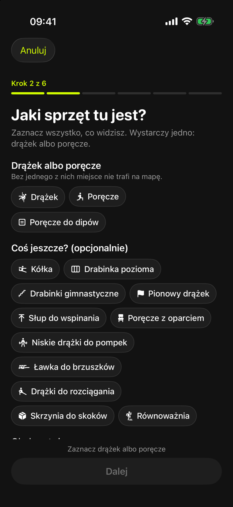 | 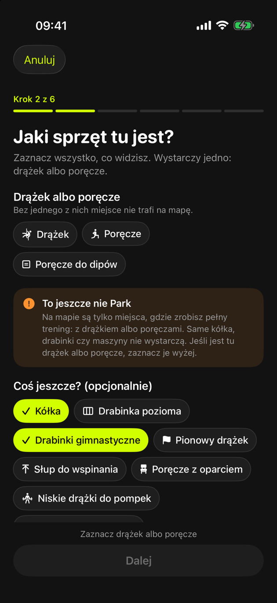 | 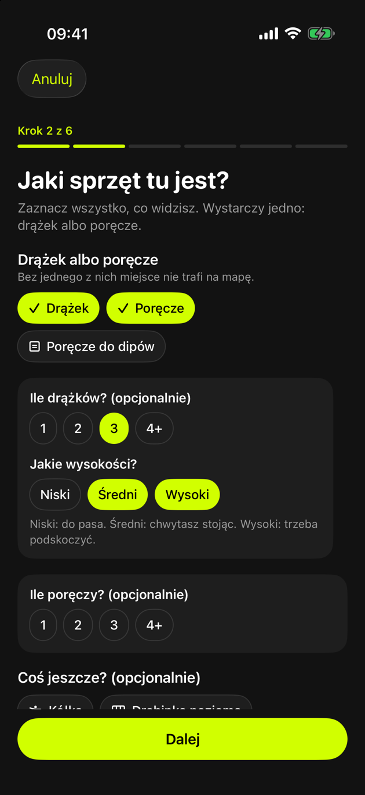 |

- **Sprzęt:** u góry trzy chipy, które same robią z miejsca Park: „Drążek”, „Poręcze”, „Poręcze do dipów”. Pod nimi reszta sprzętu z 012, w tym „Pionowy drążek” (`fitness_pole`, do flagi), „Drabinki gimnastyczne” (`wall_bars`) i „Drabinka pozioma” (`horizontal_ladder`). Klucze w kodzie są 1:1 z OSM `fitness_station`.
- **Bez drążka i poręczy:** gdy ktoś zaznaczy np. same kółka i drabinki, pojawia się „To jeszcze nie Park” z wyjaśnieniem, dlaczego.
- **Po zaznaczeniu drążka:** opcjonalnie „Ile drążków?” (1, 2, 3, 4+) i wysokości: niski, średni, wysoki, z podpowiedzią, co znaczą. Po zaznaczeniu poręczy: „Ile poręczy?”.
- Przełącznik „Obok są też maszyny” ustawia `hasMachines`. Maszyn nie wpisujemy jako sprzętu.

| Zdjęcie, pusto | Aparat | Zdjęcia zrobione |
| --- | --- | --- |
| 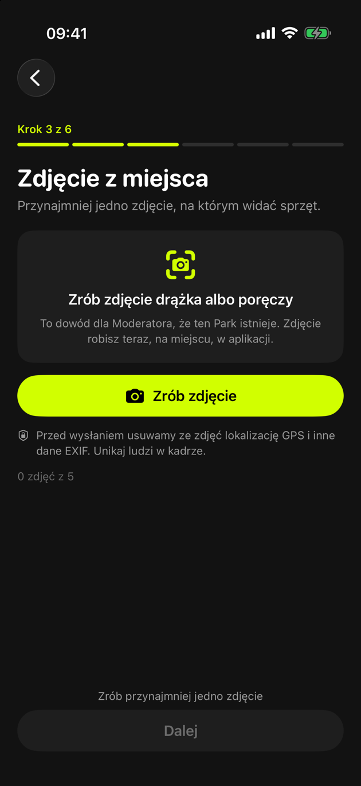 | 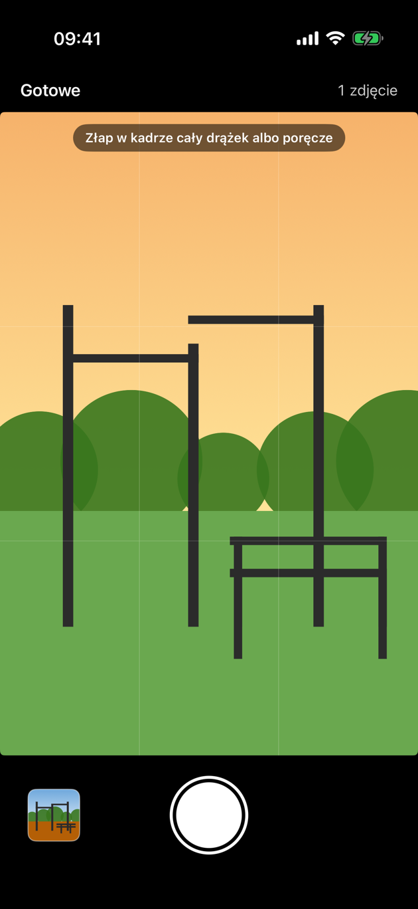 | 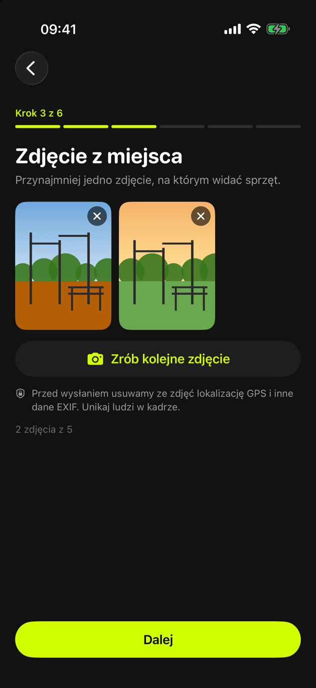 |

- **Zdjęcie z miejsca:** co najmniej 1, najwyżej 5. W prototypie aparat to atrapa: migawka dodaje narysowane „zdjęcie” drążków.
- **W prawdziwej wersji** zdjęcie robi się aparatem w apce, na miejscu, bez wyboru z galerii. **Przed wysłaniem apka usuwa ze zdjęcia lokalizację GPS i pozostałe dane EXIF** (RODO, research compliance). Ekran o tym mówi.

| Nazwa | Nazwa z błędem | Szczegóły |
| --- | --- | --- |
| 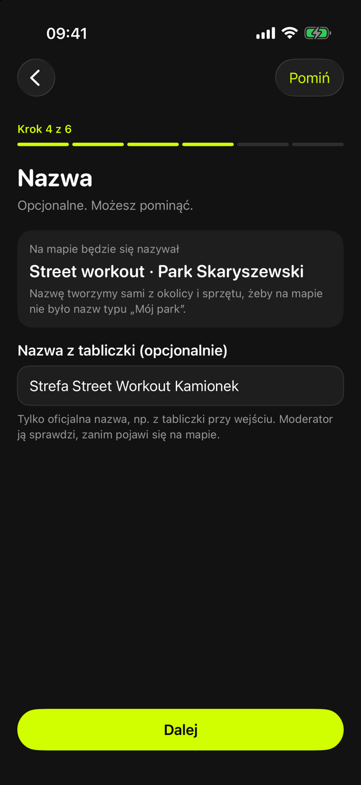 | 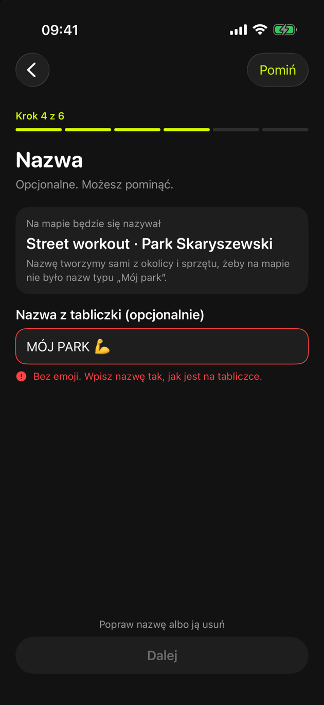 | 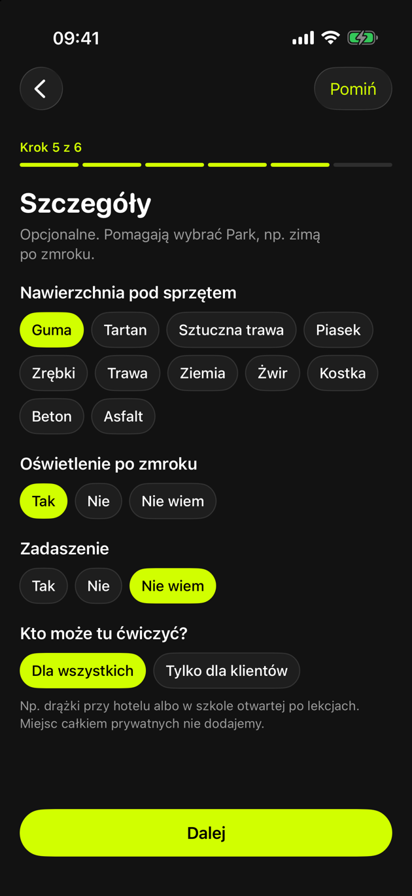 |

- **Nazwa:** pokazuje nazwę generowaną, np. „Street workout · Park Skaryszewski”. Przedrostek zależy od sprzętu, a reszta od okolicy pinezki (w prototypie kilka ręcznie wpisanych okręgów zamiast danych OSM). Pod spodem jest opcjonalne pole „Nazwa z tabliczki” z walidacją z 012: 3–40 znaków, bez emoji, linków, numerów telefonu i CAPS LOCKA.
- **Szczegóły:** nawierzchnia (wartości OSM `surface`), oświetlenie i zadaszenie (tak / nie / nie wiem) oraz dostęp (dla wszystkich / tylko dla klientów). Całość opcjonalna.

| Podsumowanie | Wysłane |
| --- | --- |
| 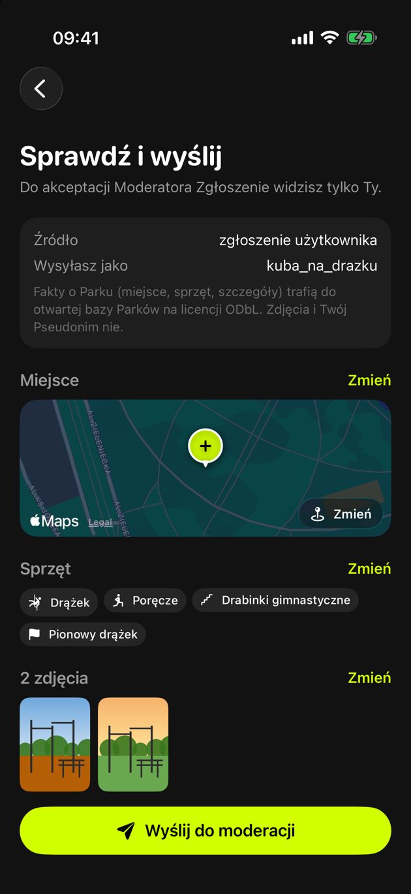 | 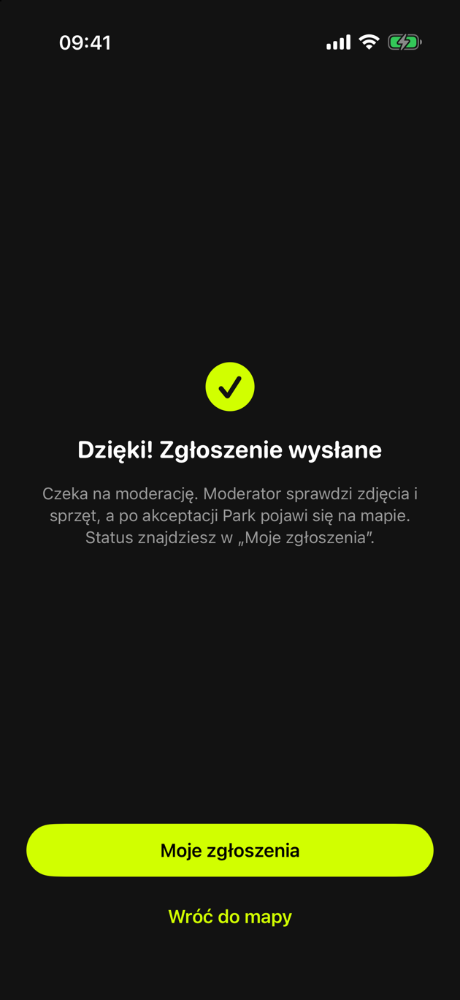 |

- **Podsumowanie:** na górze „Źródło: zgłoszenie użytkownika”, „Wysyłasz jako” z Pseudonimem i jedno zdanie o licencji ODbL. Pod spodem miejsce, sprzęt, zdjęcia, nazwa i szczegóły, każde z „Zmień”. Przycisk „Wyślij do moderacji”.
- **Wysłane:** „Dzięki! Zgłoszenie wysłane” i przejście do „Moje zgłoszenia”.

## 3. Układ B · Jeden arkusz

Wszystko na jednym przewijanym ekranie „Nowy Park”. Na górze lista wymaganych rzeczy z ptaszkami (Miejsce, Drążek lub poręcze, Zdjęcie). Sekcje mają etykiety „Wymagane” i „Opcjonalne”, a szczegóły są zwinięte. Na dole przycisk „Sprawdź i wyślij” i informacja, czego brakuje. Podsumowanie i ekran „Wysłane” są te same co w A.

| Góra arkusza | Zdjęcia | Nazwa i szczegóły (zwinięte) | Szczegóły rozwinięte | Podsumowanie |
| --- | --- | --- | --- | --- |
| 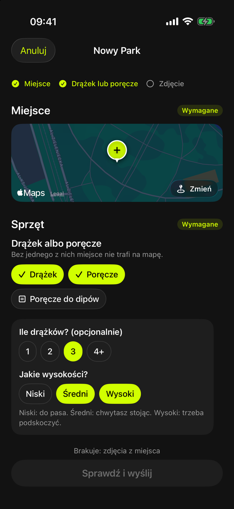 | 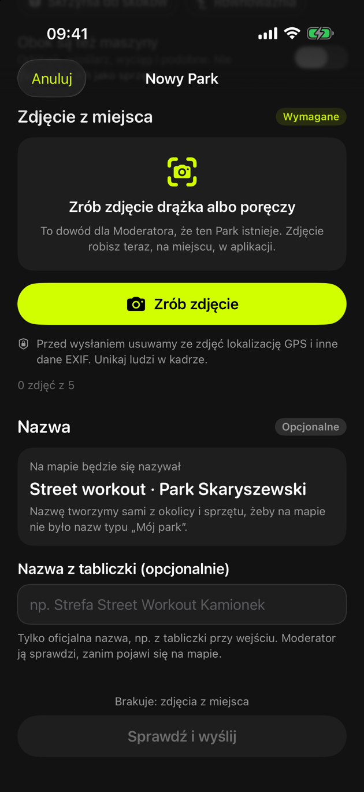 | 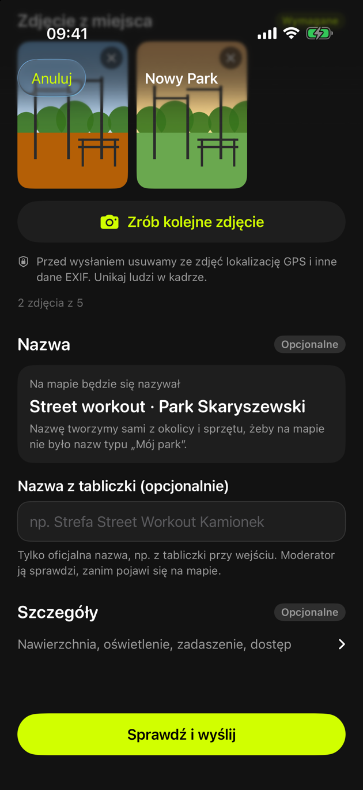 | 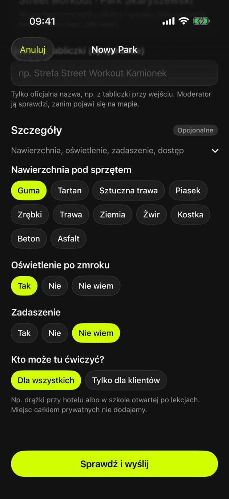 |  |

## 4. Moje zgłoszenia

| Lista | Odrzucone, z uzasadnieniem | Czeka na moderację |
| --- | --- | --- |
| 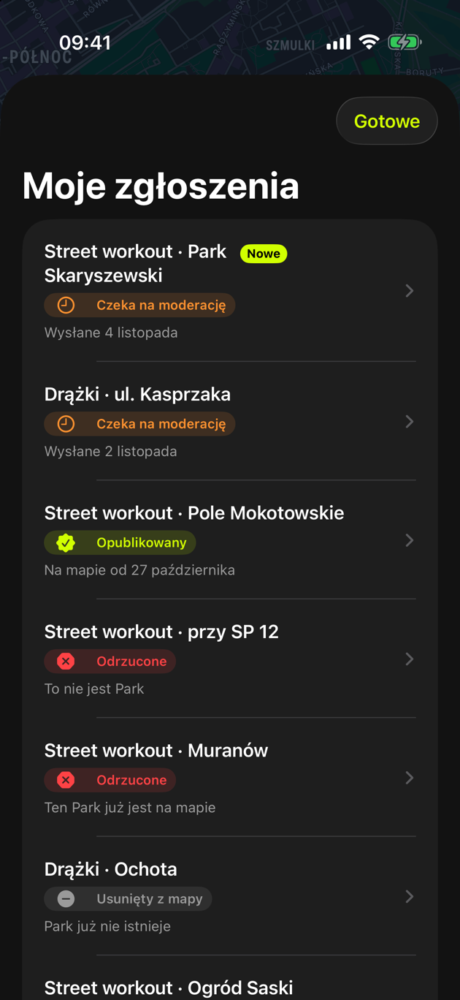 | 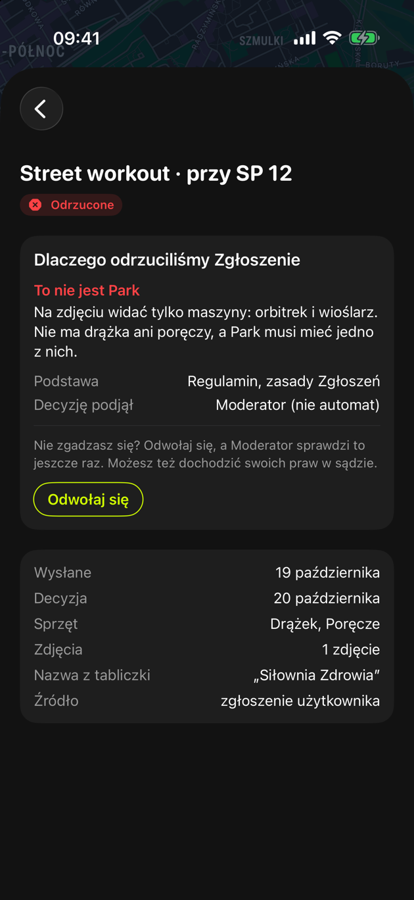 | 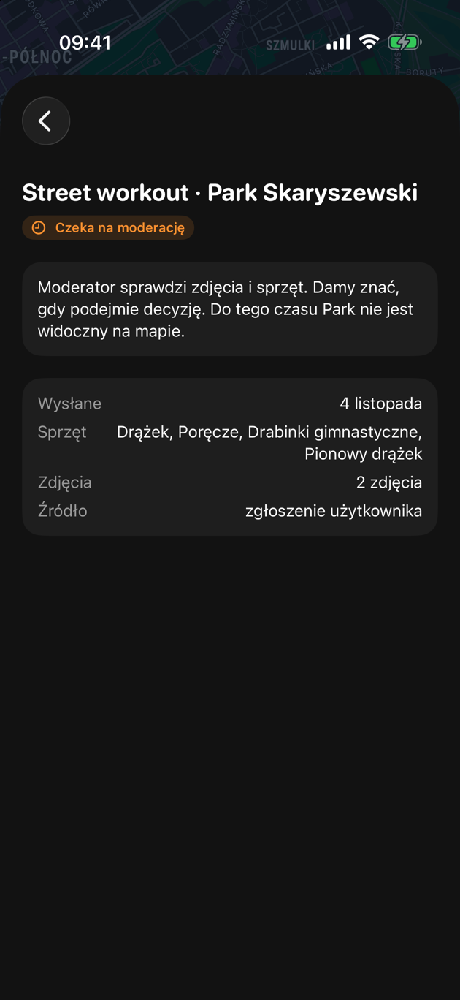 |

Statusy widoczne dla autora według 012:

- **Szkic:** tylko na tym telefonie, do dokończenia.
- **Czeka na moderację** (`pending`): nowe Zgłoszenie jest na górze z etykietą „Nowe”.
- **Opublikowany** (`published`): z przyciskiem „Otwórz Park”.
- **Odrzucone** (`rejected`): z powodem i uzasadnieniem, jak wymaga DSA art. 17. Są tam powód, wyjaśnienie, podstawa, informacja, że decyzję podjął człowiek, oraz możliwość odwołania. Przykłady: „To nie jest Park” i „Ten Park już jest na mapie”.
- **Usunięty z mapy** (`removed`): Park zdjęty po publikacji, też z uzasadnieniem.

## Jak uruchomić

W Xcode: **Product → Scheme → Edit Scheme… → Run → Arguments**, dodaj argument `-PrototypeParkSubmission` i uruchom apkę. Zamiast zwykłej apki pokaże się mapa z „Dodaj Park”. Biała pigułka u góry przełącza układ formularza (A ↔ B). Przy stawianiu pinezki pigułka ma przycisk „Demo: obok Parku”, który przesuwa mapę 27 m od istniejącego Parku, żeby zobaczyć ostrzeżenie o duplikacie. Pigułka nie jest częścią projektu.

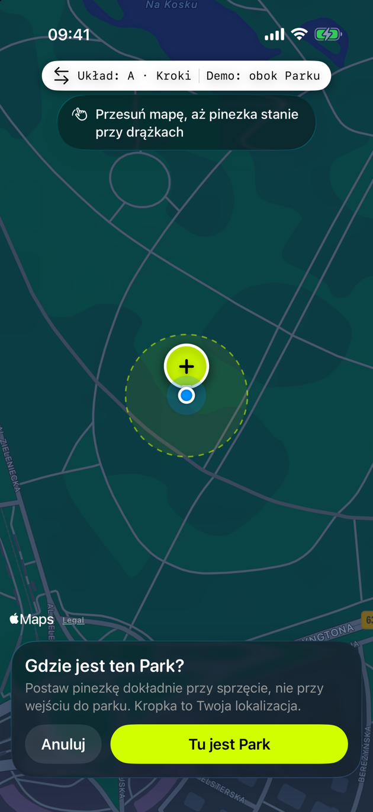

Z terminala, na włączonym symulatorze z zainstalowanym buildem Debug:

```sh
xcrun simctl launch booted com.michalbryk.cali-park -PrototypeParkSubmission
```

Dodatkowe argumenty, użyte do zrzutów:

- `-SubmissionLayout steps|sheet` wybiera układ A albo B,
- `-SubmissionScreen <nazwa>` otwiera od razu jeden ekran (lista nazw w `ParkSubmissionPrototypeModel.apply(screen:)`, np. `duplicate`, `equipment-missing`, `camera`, `summary`, `mine-rejected`),
- `-SubmissionScroll photos|name|details` przewija arkusz B do sekcji,
- `-SubmissionClean` chowa pigułkę.

## Rekomendacja

**Układ A · Kroki.** Zgłoszenie robi się w parku, często jedną ręką i w rękawiczkach. Jeden ekran to jedno pytanie, a wymagane rzeczy (sprzęt, zdjęcie) są pierwsze, więc najkrótsza droga to: pinezka, dwa chipy, jedno zdjęcie, „Pomiń”, „Pomiń”, „Wyślij”. Arkusz B lepiej pokazuje całość, ale na telefonie jest długi, a przycisk wysyłki długo zostaje wyłączony bez widocznego powodu u góry ekranu. Z B warto wziąć listę wymaganych rzeczy z ptaszkami i dodać ją nad paskiem kroków w A. Arkusz B dobrze nadałby się do poprawek istniejącego Parku (ticket 014), gdzie zmienia się jedno pole.

## Pytania do właściciela

1. **Który układ: A · Kroki czy B · Jeden arkusz?** Rekomendacja: **A**, z listą wymaganych rzeczy z B.
2. **Czy „Poręcze do dipów” (`dip_bench`) wystarczą, żeby miejsce było Parkiem?** Rozstrzygnięcie 012 mówi „drążek albo poręcze”, a to uproszczone poręcze. Rekomendacja: **tak** (tak liczy też rdzeń w 012). Prototyp już tak działa.
3. **Zdjęcie tylko z aparatu, bez galerii?** Rekomendacja: **tak w v1**. Zdjęcie z miejsca to najlepszy dowód (research OSM), a galeria otwiera drogę do zdjęć z internetu. Minus: nie zgłosisz Parku po powrocie do domu, ale szkic zostaje na telefonie.
4. **Czy telefon ma sprawdzać, że zdjęcie zrobiono blisko pinezki, zanim usunie GPS?** Rekomendacja: **tak**, np. do 200 m **[szacunek]**. Wynik idzie do Moderatora jako znacznik „zdjęcie z miejsca”, a współrzędne zdjęcia nie opuszczają telefonu.
5. **Kiedy prosić o Konto: po „Dodaj Park” czy dopiero przy „Wyślij”?** Rekomendacja: **przy „Wyślij”**. Szkic jest tylko na telefonie (012), więc nie tracimy danych, a próg wejścia jest niższy.
6. **Promień duplikatu 50 m i co z ukrytymi kandydatami z OSM (`candidate`)?** Rekomendacja: **50 m dla Parków opublikowanych i czekających na moderację**. Przy kandydacie nie pokazujemy ostrzeżenia, tylko łączymy Zgłoszenie z kandydatem na serwerze, a decyduje Moderator.
7. **Tekst o licencji ODbL na podsumowaniu.** Fakty o Parku ze Zgłoszenia trafiają do otwartej bazy, więc autor musi się na to zgodzić. Rekomendacja: **jedno zdanie na podsumowaniu plus zapis w regulaminie**. Dokładne brzmienie ustalić razem z regulaminem.
8. **Jak autor dowiaduje się o decyzji?** Rekomendacja: **w v1 status w „Moje zgłoszenia” i kropka na ikonie**. Push wymaga backendu i płatnego konta Apple Developer, więc później.
9. **Limit Zgłoszeń na Konto dziennie (012).** Rekomendacja: **5 dziennie** **[szacunek]**. Po przekroczeniu apka mówi wprost, kiedy można znowu.
10. **Gdzie ma być wejście do „Moje zgłoszenia”?** W prototypie jest ikona na mapie. Rekomendacja: **w Profilu, a na mapie tylko skrót, gdy masz Zgłoszenie w toku**.
11. **Godziny otwarcia w formularzu?** Rekomendacja: **nie**. Składnia OSM `opening_hours` jest trudna do wpisania na telefonie. Domyślnie „brak danych”, a godziny dodaje Moderator albo poprawka (ticket 014).

## Uwagi do wdrożenia

- Wysokości drążków opisane w apce jako „do pasa”, „chwytasz stojąc” i „trzeba podskoczyć” to mój **[szacunek]**, nie definicja z OSM.
- Ikony sprzętu to tymczasowe SF Symbols, jak w prototypie mapy.
- Nazwę generuje backend z danych OSM (012 §4). Apka pokazuje tylko wynik i nic z MapKit nie trafia do bazy.
- Sprawdzanie duplikatów w prawdziwej wersji idzie przez serwer, bo apka nie zna Zgłoszeń innych osób czekających na moderację.
